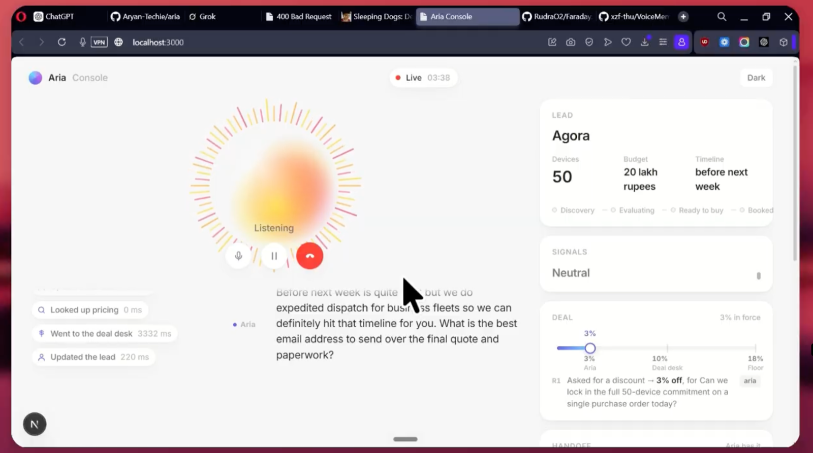
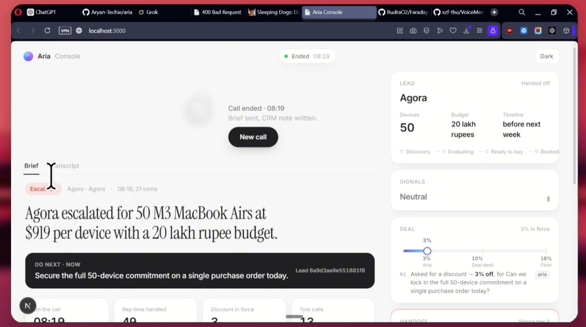
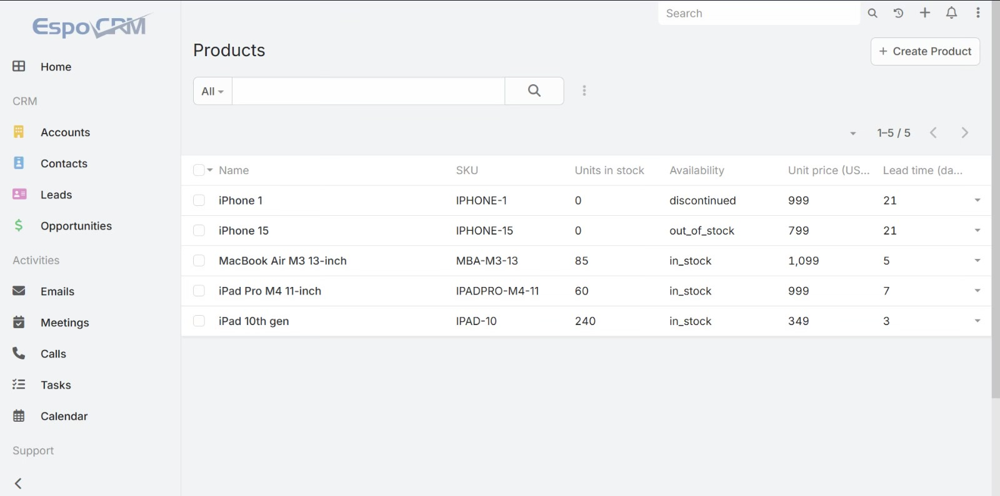
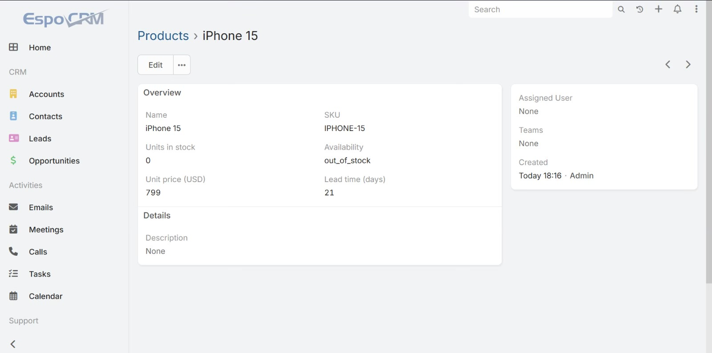
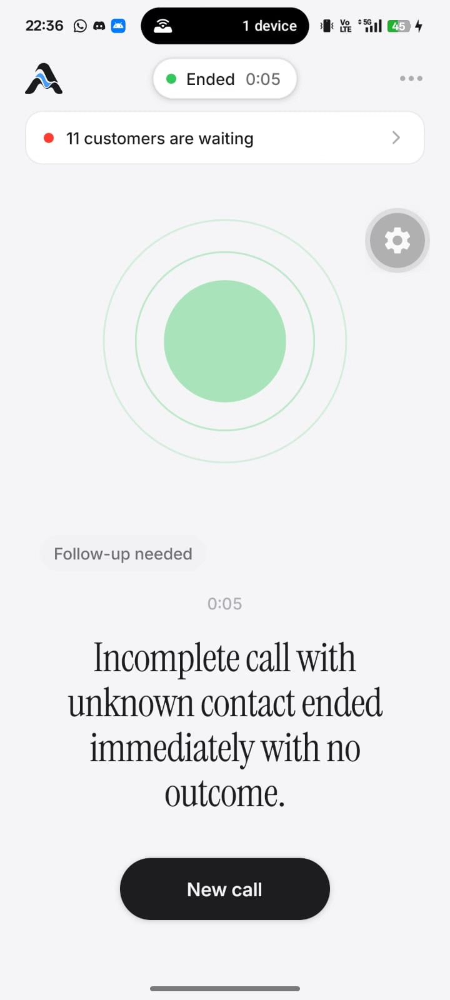

<div align="center">


# ZUNO

**The AI holds the call. A person makes the call.**

A real-time voice sales agent built human-in-the-loop: Apple devices by default, a Dior beauty boutique on request ("Dior mode"), a live CRM mirrored into Notion, and Graphify as its knowledge layer.

[](https://www.agora.io/)
[](backend)
[](frontend)
[](mobile)
[](#graphify-zunos-knowledge-layer)
[](#contributing)

*Part of the [AROICE](https://aroice.in) family of tools.*

[Features](#features) • [Quick Start](#quick-start) • [Architecture](#architecture) • [Tech Stack](#tech-stack) • [Contributing](#contributing) • [Team](#team)

**🔴 Live now:** [zuno.141-148-201-8.sslip.io](https://zuno.141-148-201-8.sslip.io) — console, ops dashboard, story and Graphify views · [crm.zuno.141-148-201-8.sslip.io](https://crm.zuno.141-148-201-8.sslip.io) — the real CRM, on an Oracle Cloud VPS behind Caddy with Let's Encrypt TLS.

</div>



Zuno runs a complete B2B sales qualification call, out loud, in real time. She answers pricing
questions from a knowledge base, handles objections, negotiates within limits she is not allowed
to cross, remembers what you told her twenty turns ago, **writes to a real CRM while you are
still talking**, books a meeting with a calendar invite, and escalates to a human — with a
written handoff brief — the moment she genuinely should.

> Open the console and a CRM lead page side by side. Say *"actually, make that fifty devices"* —
> the lead updates itself, with no refresh, while she is still speaking.




## Two modes

- **Apple (default).** Qualifies businesses buying Mac, iPhone and iPad fleets and individuals buying one device: pricing from the knowledge base, live stock, financing, AppleCare+, trade-in, meetings with a calendar invite.
- **Perfume ("Dior mode").** Say *"Dior mode"*, *"perfume mode"* or *"fragrance mode"* mid-call, or flip the console toggle, and ZUNO becomes a beauty advisor for a boutique carrying Dior fragrance, makeup and skincare (78 products, HK$ prices, scraped by `scripts/scrape_dior.py`). Its persona, knowledge base, stock, voice and negotiation rules all switch: individuals get 0% and complimentary extras, corporate gifting of 10+ pieces can reach 5%, enforced in code. *"Apple mode"* switches back. Demo only, not affiliated with Apple or Dior.
- **Product spotlight.** Whenever a product is named, by the caller or by ZUNO, it appears on the console with its image, price, note pyramid and a three.js model tinted to the product.

## Graphify: ZUNO's knowledge layer

1. **Product knowledge graphs** (`backend/app/knowledge/*.graph.json`): one per mode, built with Graphify. The solutions specialist cites their edges: `EXTRACTED` facts are stated in our documents and safe to promise; `INFERRED` ones are connections Graphify resolved, and they go to a human as open questions. Browse them at `/graph`.
2. **The team's graph on getgraphify.com:** every lead, call, objection, meeting and product is mirrored into nine linked Notion databases (`backend/app/notion/`, `scripts/setup_notion.py`, see `docs/notion.md`). getgraphify.com renders that workspace as a live knowledge graph of the sales operation.
3. **A graph of this codebase** (`graphify-out/`): Claude Code hooks route agents through `graphify query/path/explain` before they grep, `.mcp.json` serves it over MCP, and every pull request gets a Graphify impact comment (`.github/workflows/graphify.yml`).

## Contents

- [Features](#features)
- [Quick Start](#quick-start)
- [Architecture](#architecture)
- [Tech Stack](#tech-stack)
- [How a call actually flows](#how-a-call-actually-flows)
- [Three layers of who is talking](#three-layers-of-who-is-talking)
- [The console](#the-console)
- [The CRM](#the-crm)
- [Mobile app for the rep](#mobile-app-for-the-rep)
- [Configuration](#configuration)
- [Tests](#tests)
- [Proven at scale](#proven-at-scale)
- [Project layout](#project-layout)
- [Contributing](#contributing)
- [Team](#team)

## Features

- **Grounded, not scripted.** No decision tree — an LLM-driven tool-calling loop decides, turn by
  turn, whether to search product docs, update the lead, check the calendar, negotiate, or
  escalate. Every pricing/spec answer comes from a live knowledge-base search; she says "I'm not
  sure" rather than invent a number.
- **A correction is a field update, not a restart.** Change "10 devices" to "50" mid-call and one
  field on one lead changes — you don't get a second lead for the same conversation.
- **A real CRM, live.** EspoCRM in Docker backs every lead and meeting. Leads are created and
  updated mid-call, meetings are booked for real, and the CRM's own audit trail shows an agent
  genuinely working the record.
- **She bargains, and she can't give the deal away.** A three-layer negotiation: Zuno can offer up
  to 3% herself, a separate deal-desk agent can go to 10% against a real commitment, and nothing
  ever crosses an 18% walk-away floor — enforced by code, not by asking the model nicely.
- **A specialist for the technical questions.** A second agent, its own prompt and its own voice,
  answers compatibility/migration/MDM/rollout questions from the real docs — and is required to
  say exactly what it doesn't know instead of rounding a gap to reassurance.
- **Escalation is a safety net, not just the model's opinion.** Deterministic guardrails —
  repeated frustration, an unresolved objection raised three times, a low-confidence search — force
  a handoff even if the model never asks for one. Escalation is a **warm transfer**: a human joins
  the live call already briefed, and the customer never repeats themselves.
- **Booking sends a real invite.** `calendar_book_meeting` emails the customer a confirmation with
  a `.ics` attachment that lands straight in their Google or Outlook calendar.
- **Every call ends with a human being told.** Not just escalations — an AI-written wrap-up
  (headline, next action, what was already agreed) is delivered to the CRM, Slack, and email,
  independently and best-effort.
- **She can take the call in Hindi.** One `AGENT_LANGUAGE` setting moves five things together —
  ASR, TTS voice, voice boosting, greeting, and prompt — so a Hinglish call doesn't half-switch.
- **The voice changes with who's actually talking.** Zuno, the deal desk, and the solutions
  engineer each get a distinct voice, and the accent follows the caller's language mid-call.
- **A mobile app for the rep.** An Expo app that surfaces live escalations and handoff briefs, so
  the human on the other end of a warm transfer isn't stuck at a desktop.
- **Not just B2B.** Zuno reads the phrasing — "my team" vs. "I need a new phone" — and skips the
  company/role/headcount questions entirely for a solo buyer. Financing, AppleCare+, and trade-in
  work exactly the same for one device as for fifty.
- **A live ops dashboard.** `/dashboard` lists every lead and session the backend has ever seen,
  live capacity stats, open escalations (with one-click discount approval), follow-up tasks, and
  the product catalog — proof concurrency is real, not simulated.
- **A catalog a rep can extend live.** Adding a product writes real stock and re-indexes the RAG
  corpus in the same call — Zuno can answer about it on the very next question, no restart.
- **When it isn't ready to be a meeting yet.** A follow-up gets written as a real Task in the CRM,
  not a line buried in a transcript, so a rep has something to work later.
- **She does the currency math.** ₹, rupees, lakh, crore — Zuno recognizes all of them, converts
  at an approximate stated rate, and switches her own spoken currency to match the caller's.
- **A face, not just a voice.** An optional 3D avatar, lip-synced off the live remote audio track
  in real time — toggle it on mid-call, the 2D orb stays the default.

## Quick Start

**Windows — one command:**

```bat
run.bat
```

That checks your prerequisites, starts EspoCRM in Docker, provisions it, launches the backend,
opens a public tunnel, writes the tunnel URL into `.env`, restarts the backend so it picks the URL
up, starts the frontend, and opens both tabs. `run.bat stop` shuts it all down.

**Before the first run you need:**

| | Why | Get it |
|---|---|---|
| **Docker Desktop** | Runs EspoCRM + MariaDB | <https://docs.docker.com/desktop/install/windows-install/> |
| **Python 3.11+** | The backend | <https://www.python.org/downloads/> |
| **Node.js 18+** | The frontend | <https://nodejs.org/> |
| **cloudflared** | Public HTTPS URL so Agora can reach your machine | `winget install --id Cloudflare.cloudflared` |
| **A `.env`** | Credentials — see below | `copy backend\.env.example .env` |

`run.bat` verifies all five and tells you exactly what's missing before it changes anything.

**Minimum `.env` to make a call** (at the repo root, not `backend/`):

```ini
AGORA_APP_ID=...
AGORA_APP_CERTIFICATE=...
AGORA_CUSTOMER_KEY=...
AGORA_CUSTOMER_SECRET=...
ANTHROPIC_API_KEY=...
GROQ_API_KEY=...              # optional, but ~4x faster per hop
LLM_SHARED_SECRET=...         # any long random string — see Security
```

Then open **<http://localhost:3000>** and click Start. (Not the tunnel URL — that serves the
backend only.)

<details>
<summary>Manual startup, or on macOS/Linux</summary>

```bash
# 1. CRM — first run pulls images and installs its own database (~2 min)
docker compose -f crm/docker-compose.yml up -d
python scripts/provision_crm.py          # role, API key, custom fields, layout
# paste the printed ESPOCRM_* lines into .env

# 2. backend
cd backend && python -m venv .venv && .venv/bin/pip install -r requirements.txt
.venv/bin/uvicorn app.main:app --port 8000

# 3. tunnel — then put the https URL into PUBLIC_BASE_URL and RESTART the backend
cloudflared tunnel --url http://localhost:8000

# 4. frontend
cd frontend && npm install && npm run dev
```

Settings are cached with `lru_cache`, so editing `.env` while the backend runs does nothing until
it's restarted. Quick-tunnel hostnames change on **every** cloudflared start.

</details>

## Architecture

```
browser (Next.js :3000) ──RTC audio──► Agora Conversational AI Engine
                                         ASR Deepgram → LLM → TTS MiniMax
                                                │
                       POST {PUBLIC_BASE_URL}/agent/{session}/v1/chat/completions
                                                │
                                    FastAPI (:8000) ── this repo
                                      ├─ Anthropic primary / Groq for speed
                                      ├─ tool loop (10 tools, max 6 hops)
                                      ├─ deal desk + solutions engineer (layer 2)
                                      ├─ RAG over the product docs
                                      ├─ CRM + calendar ──► EspoCRM (:8080, Docker)
                                      ├─ confirmation email + .ics invite ──► SMTP
                                      ├─ escalation inbox ──► Slack + mobile app
                                      └─ SSE stream back to Agora
```

**Agora is the phone system. This backend is the person.** Agora owns WebRTC transport, the
Deepgram/MiniMax connections, voice activity detection, turn-taking, and barge-in — and calls this
backend as if it were OpenAI, streaming the response into TTS chunk by chunk. This repo owns the
persona, the tool loop, RAG, the CRM, qualification state, negotiation, escalation, and every word
she actually says. Agora never sees any of it.

The diagram above is local dev — `zuno.aroice.in` runs the identical stack on a real Oracle Cloud
VPS behind Caddy, one hostname split by path so the browser never makes a cross-origin request.
The backend runs `--workers 1` there, deliberately: sessions live in an in-process dict, so a
second worker would get its own empty copy and Agora's next webhook for a call would land on a
process that never heard of it. Scaling out means moving sessions to Redis first, not adding
workers.

## Tech Stack

| Layer | What | Why |
|---|---|---|
| **Agora Conversational AI Engine** | Real-time voice cloud (RTC audio + RTM data channel) | The whole phone-call layer — ASR, barge-in, TTS — without building real-time audio ourselves |
| **Deepgram Nova-3** | Speech-to-text, multi-language mode | Handles Hindi/English mixed in one sentence (Hinglish) |
| **MiniMax speech-2.8-turbo** | Text-to-speech, three distinct voices | Zuno, the deal desk, and the solutions engineer each sound like a different person |
| **Anthropic Claude / Groq** | The reasoning model, run on one turn | Groq for speed, Anthropic as the quality fallback — chosen by measurement, not guesswork |
| **FastAPI** | Python backend | Every tool, every rule, every word Zuno says |
| **Next.js + React** | Operator console | Live transcript, lead card, signals, deal, handoff |
| **Expo / React Native** | Mobile app for the rep | Escalations and handoff briefs on the move |
| **EspoCRM** | Open-source CRM, in Docker | The real system of record — leads and meetings, not a mock |
| **mem0 + Voyage AI** | Long-term call memory | Recalls something said early in a long call |
| **Three.js** | Optional 3D avatar | Real lipsync off live audio, plain WebGL — no react-three-fiber |
| **cloudflared** | Cloudflare Tunnel | Public HTTPS so Agora's cloud can reach a laptop during local dev |
| **Caddy + Let's Encrypt** | Reverse proxy, automatic TLS | The live deployment — one hostname split by path, real HTTPS that renews itself |
| **Oracle Cloud (ARM/A1.Flex)** | The VPS `zuno.aroice.in` runs on | Hosts console, backend, and CRM behind Caddy, `--workers 1` by design (see [Architecture](#architecture)) |
| **SMTP** | Email delivery | Confirmation invites and end-of-call wrap-ups |

## How a call actually flows

1. The customer speaks in the browser; audio goes to Agora over RTC.
2. Agora runs Deepgram ASR and gets text.
3. Agora sends that text to this backend, in the same shape as an OpenAI chat request.
4. The backend builds the prompt: Zuno's persona, the current lead state, memory recalled from
   mem0, and the tool list.
5. The model decides: answer directly, or call a tool first — search products, update the lead,
   log an objection, negotiate, ask the solutions engineer, check the calendar, book a meeting,
   or escalate.
6. The tool runs, the result feeds back, and the model writes the reply.
7. The reply streams back to Agora token by token, so TTS starts on the first chunk.
8. Every tool call and transcript turn is written to the session's event log, which the console
   polls and renders live.

## Three layers of who is talking

- **Layer 1 — Zuno.** The only one who talks to the customer. Warm, generalist, holds the
  conversation and can offer up to 3% off on her own.
- **Layer 2 — two specialists.** Neither talks to the customer directly; Zuno relays the answer,
  in a distinct voice.
  - **Deal desk** — reasons about margin. Can go to 10%, only against a real commitment, and
    every round moves less than the last so the floor is felt coming.
  - **Solutions engineer** — handles compatibility, migration, MDM, and rollout questions from the
    real docs, and is required to state exactly what it doesn't know.
- **Layer 3 — a human.** Reached by escalation, as a **warm transfer**: they join the live call
  already knowing the context, and the customer never repeats themselves.

## The console

- **Orb + caption** — who is speaking, driven by real audio levels.
- **Transcript** — customer and Zuno turns, streamed live as words are generated.
- **Tool calls** — every tool fired, with its latency in milliseconds.
- **Lead** — company, devices, budget, timeline, and the qualification stage.
- **Signals** — sentiment right now.
- **Deal** — the three limits (Zuno/desk/floor) and every round offered.
- **Handoff** — the escalation guardrails filling up live, then the join link.
- **Brief** — after the call ends, the AI-written wrap-up for the rep.

## The CRM

Not a mock — a real **EspoCRM** instance, running in Docker, backing every product, lead, and
meeting Zuno touches.

<p align="center">
  
  
</p>

`scripts/provision_crm.py` sets it up headlessly — role, API key, custom fields, and layout — so
it's reproducible on a fresh machine instead of twenty minutes of clicking.

## Mobile app for the rep

A warm transfer needs somewhere for the human to land. The Expo app surfaces the live escalation
queue and each call's AI-written brief, so a rep isn't stuck at a desktop waiting for a handoff.

<p align="center">
  
</p>

## The Configuration

Everything is environment-driven — see `backend/.env.example` for the full annotated list.

| Variable | Purpose |
|---|---|
| `PUBLIC_BASE_URL` | Public HTTPS URL Agora calls back into — changes on every tunnel restart |
| `LLM_SHARED_SECRET` | Required — the webhook is public; this is what stops a stranger using your LLM bill |
| `LLM_PROVIDER` | `groq` (default, fast) or `anthropic` |
| `CRM_BACKEND` | `espocrm` or `memory` (automatic fallback if EspoCRM is unreachable) |
| `EMAIL_ENABLED` | Confirmation email + `.ics` invite on booking — off by default |
| `AGENT_LANGUAGE` | `en`, `hi`, or `hinglish` — moves ASR, voice, boost, greeting and prompt together |
| `VOICE_SWITCHING_ENABLED` | Follow the caller's language and give each layer its own voice |

## Tests

```bash
cd backend && python -m pytest
```

293 tests, ~2 seconds, zero network calls — the full tool loop runs against fake models and fake
stores: corrections, escalation rules, deal clamping, voice selection, and the LLM endpoint.

## Proven at scale

`scripts/capacity_test.py` runs the real six-beat call script — CRM writes, deal-desk consult,
RAG search, calendar lookup — through the real turn loop, concurrently. Only the model itself is
stubbed.

| | |
|---|---|
| **Concurrent calls** | 256 |
| **Turns handled** | 1,536 in 1.91s |
| **p95 latency** | 0.30s |
| **Failed turns** | 0 |

At 512 concurrent calls: 3,072 turns in 6.34s (485/s), p95 1.04s, still zero failed. It found a
genuine concurrency bug on its first serious run — before that bug ever reached a live call.

## Project Layout

| Path | What |
|---|---|
| `backend/app/orchestrator/pipeline.py` | The turn loop — `run_turn_stream` is the production path |
| `backend/app/deal/` | The negotiation engine: policy, clamp, and the deal-desk agent |
| `backend/app/specialists/solutions.py` | The solutions engineer, and what it refuses to claim |
| `backend/app/crm/` · `backend/app/calendar/` | EspoCRM leads and meetings |
| `backend/app/notify/` | Confirmation email, `.ics` invite, and the end-of-call wrap-up |
| `backend/app/language/profiles.py` | English / Hindi / Hinglish, and the settings that must agree |
| `backend/app/voice/director.py` | Who speaks, in what accent, and when it's worth a round-trip |
| `backend/app/tasks/` | Follow-up tasks — written as real EspoCRM Tasks, not transcript notes |
| `frontend/app/page.tsx` | The Next.js operator console |
| `frontend/app/dashboard/` | The ops dashboard — leads, capacity, escalations, catalog, in one view |
| `frontend/app/about/` | The project's own story/architecture page |
| `frontend/components/Avatar3D.tsx` · `lib/lipsync.ts` | The optional 3D avatar and its real-time lipsync |
| `mobile/` | The Expo app for the rep |
| `crm/` | EspoCRM + MariaDB Docker setup, and `scripts/provision_crm.py` |
| `deploy/` | The live-VPS deployment — Caddy, docker-compose, `up.sh` |

## Contributing

Contributions are welcome. Open an issue for a bug or a feature idea, or send a pull request —
please describe what changed and why in the PR description.

## Team

Built by **Team AR Voice**, under **[AROICE](https://aroice.in)**.

| | |
|---|---|
| **Aryan Techie** (Aryan Jangra) | [GitHub](https://github.com/aryan-techie) · [LinkedIn](https://www.linkedin.com/in/aryantechie) |
| **Rudra Pratap Singh** | [GitHub](https://github.com/RudraO2) |
| **Shipra Porwal** | [LinkedIn](https://www.linkedin.com/in/shipra-porwal-61229a219/) | [GitHub](https://github.com/shiprapr)

---

<div align="center">

**Made with ❤️ by [AROICE](https://aroice.in)**

</div>
